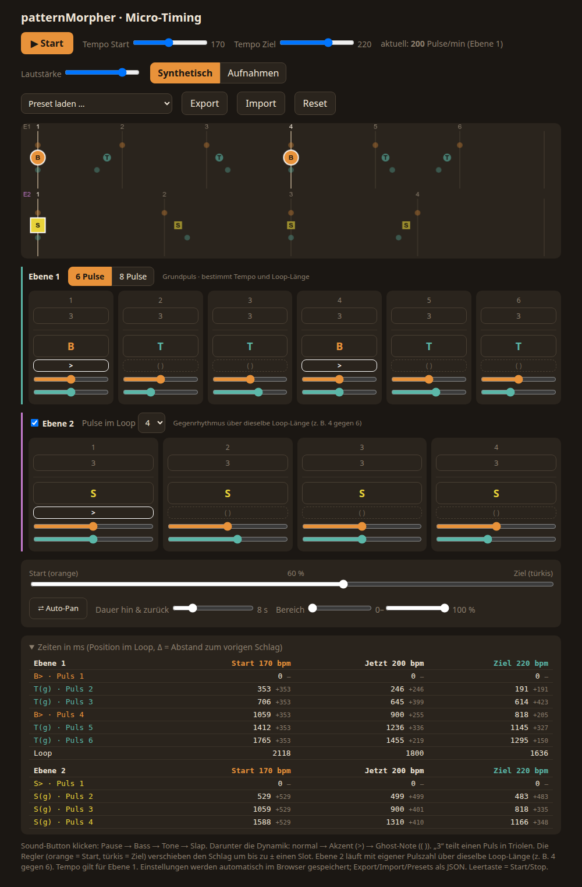

# patternMorpher

Werkzeug zum Erkunden von **Micro-Timing** in Djembe-Patterns.

Ein Pattern läuft im Loop (Puls 6 oder 8). Du legst Töne und Pausen darauf und verschiebst die Schläge zeitlich – die Loop-Länge bleibt gleich. Es gibt immer zwei Zustände, **Start** und **Ziel**: gleiche Töne, aber anderes Micro-Timing und anderes Tempo. Ein Slider blendet stufenlos zwischen beiden über. So hört man, wie das Micro-Timing das *Feeling* eines Patterns auch bei unterschiedlichem Tempo zusammenhält.



## Funktionen

- **Sounds:** Bass, Tone (open) und Slap – synthetisch oder als Aufnahmen (`samples/`)
- **Puls 6 oder 8**, jeder Puls optional in **Triolen** unterteilbar
- **Micro-Timing** pro Schlag: ein Regler für Start (orange), einer für Ziel (türkis)
- **Tempo Start / Ziel**, der Morph-Slider blendet Timing *und* Tempo über
- **Auto-Pan:** pendelt automatisch hin und her, mit einstellbarer Dauer und einstellbarem Bereich (z. B. nur 30–80 %, wo es groovt)
- **Akzent und Ghost-Note** pro Schlag
- **Zweite Ebene** mit eigener Pulszahl über dieselbe Loop-Länge (z. B. 4 gegen 6)
- **Zeiten-Tabelle** in ms (Position und Abstand zum vorigen Schlag) für Start, Ziel und aktuellen Stand
- Automatisches Speichern im Browser, **Export / Import / Presets** als JSON

## Benutzen

Online: https://redpanther.github.io/patternMorpher/

Lokal – die Aufnahmen werden per `fetch` geladen, dafür braucht der Browser einen Webserver (per Doppelklick auf `index.html` geht nur „Synthetisch“):

```bash
python3 -m http.server 8000
# dann http://localhost:8000 öffnen
```

Leertaste = Start/Stop.

## Presets

Ein Preset ist eine JSON-Datei im Ordner `presets/`. Am einfachsten erzeugst du sie mit **Export** in der App (dort kannst du einen Namen vergeben) und legst die Datei in `presets/` ab. Der Name aus dem Feld `name` erscheint im Auswahlmenü.

Das Menü liest `presets/index.json`. Diese Datei wird vom Workflow beim Deploy automatisch erzeugt; lokal erzeugst du sie mit:

```bash
python3 tools/gen_presets_index.py
```

Ein Preset lässt sich auch direkt verlinken: `index.html?preset=6-gegen-4` lädt `presets/6-gegen-4.json`.

## Deployment

Jeder Push auf `main` veröffentlicht die Seite über GitHub Pages (`.github/workflows/pages.yml`). Voraussetzung: in den Repo-Einstellungen unter *Pages* ist als Quelle **GitHub Actions** gewählt.

## Lizenz

Siehe [LICENSE](LICENSE).
